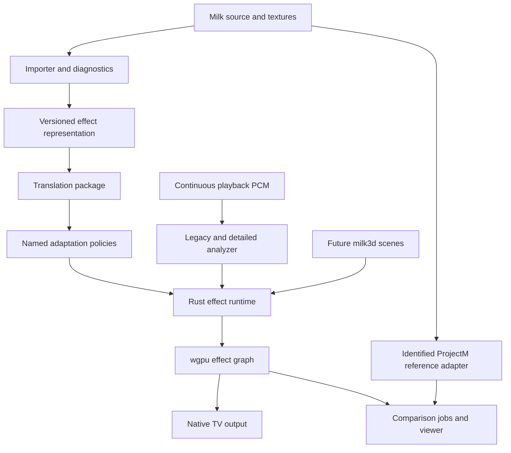
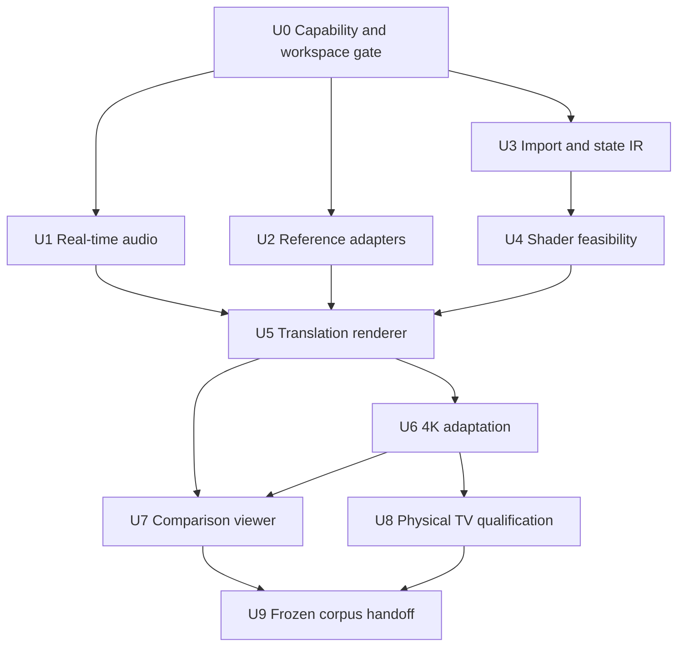

# Rust MilkDrop Adaptation Implementation Plan

## Current user decisions (override earlier certification proposals below)

Latest format decision: use one independent `.beat` package/graph for 2D, 3D and mixed effects, without MilkDrop limitations. Shipping playback must not require `.milk` or ProjectM. The evolving local predictor is build-time evidence for adaptation; the user reviews visual quality. `docs/BEAT_FORMAT.md` defines the new contract. Existing equation/warp/composite packages and current movies remain a separately identified baseline, not a completed `.beat` implementation. Earlier extension-only wording below is superseded.

The user selected M4-hosted **emulated Android TV**, with no physical TV needed
for the PoC. R7 now applies to emulator playback/performance; later physical-TV
certification sections are deferred and are not PoC completion gates. Do not
continue operating physical devices for this task. Build an isolated 4K TV AVD.

Prioritize visual/audio fidelity and performance above exact likeness. The
adapted output must look good and work across all 100, with native 3840×2160
feedback/output, deliberate substantial stroke coverage (start at ≥3 native
pixels; inspect for excessive deposited energy), and no low-resolution authored
canvas or whole-image upscale. Compare visual quality and measured performance
against the user's ProjectM-TV Android player under labeled matching settings.
Original behavior remains selectable as a comparison path; exact pixel likeness
is not the product goal. No extra user approval rounds are required.

> For agentic workers: use a task-by-task implementation workflow such as the
> `superpowers:executing-plans` skill, or `superpowers:subagent-driven-development`
> when explicitly selected. Track implementation using the checkboxes below.

**Goal:** Adapt existing `.milk` programs into compact modern effects with
critical real-time bass and melodic response, native 3840×2160 playback at a
minimum of 30 fps on declared TV hardware, and a clean extension to `.beat`.

**Architecture:** A Rust importer/compiler produces a versioned,
engine-independent effect package. A Rust runtime evaluates ordered CPU state,
consumes timestamped legacy and rich audio features, and renders a typed effect
graph through wgpu. Independent reference adapters and a synchronized viewer
make translation/adaptation differences easy to inspect.

**Tech stack:** Rust stable, Cargo workspace, wgpu/Naga, winit for the desktop
viewer, RustFFT, serde/serde_json, clap, image decoding and SHA256 support.
Compiler tooling stays on the workstation. A minimal Android shell owns platform
surfaces/lifecycle/capture and calls Rust. Exact compatible versions are locked
in U0; researched starting candidates are wgpu 30.0.1 and winit 0.30.13, not a
verified resolved dependency set.

**Spec:** [REQUIREMENTS.md](REQUIREMENTS.md),
[audio design](docs/AUDIO_DESIGN.md),
[comparison protocol](docs/COMPARISON_PROTOCOL.md).

## Global constraints

- Preserve the 100 original presets and 74 texture files with their exact hashes.
- Build adaptation from source translation; retain translation-only mode.
- Audio reactivity, especially electronic-music bass and melodic movement, is a
  first-delivery requirement, not post-processing polish.
- Run detailed audio analysis independently of the rendering cadence; distinguish
  source quality and feature latency. Initial delivery excludes stem separation.
- Native certification uses 3840×2160 primary feedback and final composite.
  Smaller blur intermediates are allowed only as declared effect design.
- Thirty fps means meeting the declared frame deadlines, not an average-only
  number. Measure the M4-hosted Android TV emulator for this PoC and label that
  evidence honestly. Physical-TV speed claims require separate later evidence.
- Do not modify sibling production sources, frozen workers or historical evidence
  while implementing this project. New reference instrumentation is isolated.
- Use `.beat` for 2D, 3D and mixed effects, with one shared graph/audio/resource
  contract. Keep legacy parsing/prediction offline. Add actual 3D execution in
  its own milestone without building a general game engine.
- No fabricated conversion success, fallback-shader success, instrument isolation
  or fidelity percentage. Unsupported and unmeasured states remain visible.

## Review focus

1. Continuous playback PCM from the intended TV music app is unavailable: fail
   the input gate visibly and use a permitted PCM player/host integration.
   Visualizer snapshots are rejected, not an accepted fallback (R17; U0/U1/U8).
2. Complex stateful equations or legacy HLSL compile but change evaluation,
   sampling, precision or random behavior: report divergence and retain a
   translation-only diagnostic path (U3/U4/U5).
3. Bass dominates the similarity score while melodies stop affecting the image:
   use separate control/intervention audio and acceptance decisions (U1/U6/U7).
4. Reported 4K output hides lower-resolution primary feedback, capture overhead
   hides actual speed, or average FPS hides deadline misses: inspect actual
   allocations and presented frames under sustained load (U5/U8).
5. Source switch, resume, device loss or preset transition reuses stale audio or
   GPU resources: generation isolation and bounded lifetime rules apply
   throughout the runtime (U1/U5/U8/U9).

## Requirements trace

| Requirements | Delivery units |
|---|---|
| R1 Rust; R11 engineer handoff | U0 and all units |
| R2 frozen corpus; R10 complete denominator | Existing corpus, U0/U3/U9 |
| R3 translation baseline | U2/U3/U4/U5 |
| R4 explicit adaptation | U6/U9 |
| R5 easy comparisons | U2/U7 |
| R6 native 4K; R7 minimum 30 fps | U0/U5/U8/U9 |
| R8 compact packages; R9 unified `.beat`; R19–R21 independent graph/prediction | U3/U5/U9/U10 |
| R12–R14 detailed audio, comparison bindings, no stems | U0/U1/U2/U6/U8 |
| R15 bass; R16 melodic movement | U1/U6/U7/U8/U9 |
| R17 continuous higher-fidelity playback PCM; no Visualizer fallback | U0/U1/U8/U9 |

## Starting evidence and corpus

Implementation progress: `docs/implementation/PROGRESS.md`. The current Rust
inspector verifies/parses all 100 originals; conversion/render status remains
pending in `reports/inspect.json`. The standalone PCM test shell builds and has
physical AM9 Pro capture evidence. The intended player is the user's
`johnneerdael/Milkbeat`; prefer its direct Media3 PCM path for final integration
and preserve stereo before its existing mono visualizer tap. Integration is
not implemented yet. See `docs/MILKBEAT_INTEGRATION.md`.

The source folder is `../Projectm-TV/core/src/main/assets/presets/`: exactly 9,606
files observed at preparation time. The copied random sample is identified in
`corpus/manifest.json`; `corpus/SAMPLING.md` gives the language-independent
seeded ranking. Development ranks 1–80 and holdout ranks 81–100 are fixed.
All 74 packaged textures were copied because dynamic selectors can require the
entire candidate catalog. Missing external assets are still possible.

Lexical sample hints: 87 presets contain shader sections, 51 have enabled custom
waves, 61 enabled custom shapes, 65 mention `rand(...)`, and 78 mention `texsize`.
These overlapping counts are not supported-feature claims. The existing
ProjectM-TV README describes a filtered Cream of the Crop library; the sample
represents those 9,606 files, not every preset ever authored.

Reference code and learnings:

- `../milkdrop2/src/ns-eel2/ns-eel.h`: equation values default to double precision.
- `../milkdrop2/src/vis_milk2/state.cpp`: variable scopes, initialization and
  q/t state transfers. `milkdropfs.cpp`: warp mesh, waves/shapes, fixed pixel
  drawing offsets and sampling conventions.
- `../milkdrop2/src/vis_milk2/plugin.cpp`: legacy shader profiles and audio
  analysis, including waveform windows, spectrum bands and relative smoothing.
- `../Projectm-TV/app/src/main/java/com/example/projectm/visualizer/PlayerSessionFinder.java`
  and `MainActivity.java`: actual player-session Visualizer attachment, waveform
  callbacks enabled, FFT callbacks disabled, and shared-effect polling fallback.
  The waveform carries spectral information; its delivery is 8-bit mono snapshots.
- `../Projectm-TV/tools/preset-lab/README.md` and worker sources: a deterministic
  development oracle with a private engine build, not the Android shipping core.
- `../Projectm-TV/tools/core-corpus/README.md` and frozen random-100 evidence:
  source-bound Android captures, RNG/clock controls and complete input identity.
- `../Projectm-TV/docs/superpowers/specs/2026-10-03-native-4k-feedback-diffusion-design.md`:
  historical PoC showing feedback-scale sensitivity and concrete over-blur
  regressions. It is a research lead, not a description of current shipping code
  or an accepted universal adaptation formula.
- No `docs/solutions/` or code graph was present in the source checkout at this
  handoff. Source-head and asset hashes in the corpus do not identify an oracle
  binary; freeze each actual producer separately.

## Technical decisions

| Decision | Rationale and boundary |
|---|---|
| Offline Rust conversion; lean Rust playback | Move parsing, diagnostics and compiler tooling off the TV; device pipeline creation/prewarming still exists. |
| Engine-independent effect IR | Keep source provenance and adaptation decisions portable; wgpu handles/resources never enter serialized IR. |
| CPU f64 ordered equation execution first | Preserve state/order/rand semantics; the GPU draws millions of pixels while the legacy “per-pixel” equations often run on a mesh. |
| Fragment/render-pass baseline | Covers more TV hardware; compute accelerations require measured capability and benefit, not an unconditional dependency. |
| WGSL as preferred portable shader artifact | Native SPIR-V can be an explicitly declared alternate artifact if the compiler spike warrants it; never bypass validation silently. |
| Legacy and enriched audio coexist | Baseline comparisons stay meaningful; explicit new mappings exploit faster/detail-rich features without changing legacy names covertly. |
| Native feedback plus declared logical scale | Address spatial behavior without disguising an upscaled low-resolution visualization as native 4K. |
| RGBA8 behavior first; HDR optional later | Float buffers, sRGB conversion and tone mapping alter clipping/feedback; greater precision is not automatically greater compatibility. |
| `.beat` shares audio, timing and effect graph | Add typed scene color/depth later; keep 2D conversion independent of future 3D authoring. |

Use existing dependency implementations for parsing infrastructure, FFT, image
decode, serialization, hashing and graphics. A small custom equation VM may be
necessary because ordinary math-expression libraries do not reproduce NS-EEL's
ordered assignments, scopes and state semantics. Characterize those behaviors
against reference code; do not implement a new general-purpose compiler/JIT.

Declare preset containment limits separately from normal frame-budget targets:
source bytes/parser nesting, decoded image dimensions/bytes, VM instructions per
invocation and state/memory, total graph allocation and compiler subprocess
time/output. U0 records source size/resource high-water marks; U3 selects bounded
limits that accommodate supported fixtures and publishes them in package/runtime
metadata. Reject oversized assets before excessive allocation. Over-budget VM
execution aborts that invocation/preset with a diagnostic and returns to a usable
player state. Unknown/unbounded shader loops require explicit unsupported status
or a documented bounded lowering; validation alone is not a runtime cost bound.

## Architecture and contracts

This diagram illustrates the intended approach and is directional guidance for
review, not implementation code.

### Workspace boundaries (create during implementation)

| Package / paths | Owns |
|---|---|
| `crates/effect-model/src/{manifest,ir,audio,capabilities,diagnostics}.rs` | Versioned data contracts, source maps, required features and schema migrations |
| `crates/milk-import/src/{parser,equations,assets}.rs` | Byte-preserving source parsing, equation AST, texture catalog/dependency resolution |
| `crates/milk-compile/src/{lower,shader,adapt,package}.rs` | Ordered equation bytecode, compiler route, explicit transformations and atomic package output |
| `crates/audio-analysis/src/{input,legacy,spectrum,onset,tonal,snapshot}.rs` | Sample-clock analysis, legacy bands, detailed bass/tonal features and coherent snapshots |
| `crates/effect-runtime/src/{state,vm,bindings,clock}.rs` | Per-instance CPU state, bounded equation execution and audio/effect binding |
| `crates/effect-render/src/{graph,resources,geometry,feedback,pipeline}.rs` | wgpu resources/passes, drawing, feedback and pipeline prewarm |
| `crates/compare/src/{job,reference,frames,metrics,review}.rs` | Frozen jobs, reference subprocess adapters, comparison output and review records |
| `apps/cli/src/main.rs` | Inspect/convert/render/compare/bench entry points and JSON results |
| `apps/viewer/src/{main,timeline,panels}.rs` | Desktop synchronized clips, diagnostics and feature plots |
| `platform/android/` | Small independent TV test app, surface/lifecycle and negotiated audio input bridge |
| `schemas/`, `tests/fixtures/`, `tests/integration/`, `docs/` | External contracts, semantic controls, cross-package validation and reference/budget documentation |

Package boundaries are responsibility boundaries; combine tiny modules when
they add no clarity. Do not create microservices, a plugin bus or a generic ECS
in this first implementation.
Register `tests/integration/` as an explicit Cargo workspace test-harness package
with its own `Cargo.toml` and declared integration-test targets for the proposed
`.rs` files. A virtual workspace root does not automatically execute loose root
integration tests.

### Serialized package

Use a versioned manifest plus equation bytecode, portable shader artifacts,
source maps and hash-addressed assets. Keep original source identity, author,
converter version, required GPU/audio capabilities, coordinate/color conventions,
adaptation policy/parameters and diagnostic coverage. A shared texture store
avoids duplicating the 74 textures in every effect. Produce package size reports;
do not promise a specific compression ratio. Preserve source `.milk` separately.

Write derived packages to `effects/<source-id>/<package-hash>/`; originals remain
in `corpus/`. Publish an output pointer only after all artifacts validate.
Failed conversion leaves no half-valid playable package. Hash compiler versions,
normalization rules, IR, source/assets and policy into the package identity.

### Runtime and graph

Model passes with typed color/depth outputs, read/write resources, stage order,
format/transfer conventions and explicit history edges. Ping-pong feedback is
a declared history resource; ordinary graph cycles are invalid. Maintain separate
per-preset equation/RNG/audio-binding state. Record reference-coordinate versus
physical pixel units. Alpha/additive blending, half-texel conventions, mip/LOD,
wrap/filter rules and texture orientation are part of translation behavior.

Cache resources/programs; prewarm the next preset outside the visible critical
path. Retire resources only after GPU work and all current/outgoing uses finish.
Invalidate stale device-generation handles after device loss or Android resume.
A future scene pass supplies color/depth to the same graph; legacy encoded-color
feedback and future linear/HDR scene color meet through explicit conversion.

### Audio/effect binding

Implement the detailed design in `docs/AUDIO_DESIGN.md`. Keep legacy feature
names and ordered evaluation intact in translation-only mode. Adapted presets
may additionally bind band envelopes, low-band onset, sustained bass, tonal
change, chroma and stereo features through named, recorded mappings. Mappings
have units, gain, attack/release, validity and sample timestamps; do not turn
every musical event into the same brightness pulse.

Bass and melody must both produce independently inspectable visual effects
where the chosen adapted preset supports them. Preserve the author's existing
reaction first; richer mappings are optional per-preset adaptations with their
own comparison. Do not impose generic reactions on authored intentionally quiet
passages or rewrite unknown dependency graphs heuristically without diagnostics.

## Execution sequence and milestones

Milestone A, U0–U4: real input/capability evidence, detailed audio prototype,
reference clips, inspect inventory and measured shader feasibility.
Milestone B, U5–U7: a small end-to-end translated/adapted set with easy synchronized
comparison and independent bass/melody review.
Milestone C, U8–U9: physical native-4K qualification, complete 100-preset outcomes,
frozen policy/holdout evidence and `.beat` extension contracts.
Do not wait for full-corpus coverage before measuring one real preset on the TV.

## Implementation units

### U0 — Workspace, corpus verification and hardware/input feasibility

**Requirements:** R1/R2/R6/R7/R10–R12. **Dependencies:** supplied corpus only.

**Files:** Create `Cargo.toml`, `rust-toolchain.toml`, `.gitignore`,
`docs/TARGET_HARDWARE.md`, `docs/DEPENDENCIES.md`,
`crates/effect-model/src/capabilities.rs`, `apps/cli/src/main.rs` and
`tests/integration/corpus_identity.rs`, `tests/integration/capabilities.rs`.
Create `tests/integration/Cargo.toml` and register these test targets explicitly.

**Consumes:** `corpus/manifest.json`, exact fixture bytes and user hardware choice.
**Produces:** locked compatible toolchain/dependencies, device/audio capability
records and `inspect` corpus-validation result with all 100 input identities.

- [x] Verify the complete corpus and population manifest, preserve Unicode paths,
  and record source-assets identity independently of source Git HEAD.
- [ ] Select and record one minimum physical TV model/SoC/GPU/OS and the intended
  music input app. Enumerate actual wgpu adapter, limits, formats, presentation,
  timestamps and optional compute support. Prove a real 3840×2160 surface.
- [ ] Prove continuous higher-fidelity playback PCM capture (R17).
  Confirm platform consent/capture policy and source-change behavior. Audio
  availability is an early product feasibility gate, not a final surprise.
  Use AudioPlaybackCapture + AudioRecord with consent and capture-policy checks.
  Target stereo 48 kHz i16/f32; report format/timestamp accuracy and verify real
  signal content. Visualizer snapshots cannot satisfy this gate; no microphone
  substitution is allowed.
- [ ] Lock compatible dependencies and compiler tools; record MSRV, licenses and
  required feature flags. Keep Rust compilation/native linking and external
  compiler invocation errors distinct from preset conversion failures.

**Tests:** altered preset/texture/inventory hash fails; duplicate or unsafe paths
fail; all exact original names survive. A mock 2,048-texture limit rejects native
4K requirements. Missing filterable float formats or timestamps is explicit.
Unavailable audio produces an unavailable tier, not silent usable-PCM status.

**Gate:** suitable hardware/input path identified, or an explicit capability
failure with a revised hardware target. Parser/reference work can continue
without a physical device; performance/audio-source certification cannot.

### U1 — Critical real-time bass, spectral and melodic analysis

**Requirements:** R12–R16; R1/R5/R7. **Dependencies:** U0 contracts.

**Files:** Create `crates/audio-analysis/src/{input,legacy,spectrum,onset,tonal,snapshot}.rs`,
`crates/effect-model/src/audio.rs`, `crates/audio-analysis/tests/{legacy,spectral,bass,tonal,latency,lifecycle}.rs`,
`tests/fixtures/audio/` and `schemas/audio-features-v1.json`.

**Consumes:** timestamped input blocks plus quality/rate/channel/generation metadata.
**Produces:** coherent timestamped legacy/rich snapshots and bounded onset events,
with confidence/validity, feature-age/drop/cost metrics and deterministic traces.

- [ ] Characterize legacy waveform/FFT/band/relative-normalization behavior using
  the selected reference producer before implementing compatible fields.
- [ ] Implement preplanned multi-resolution FFT/envelope analysis with RustFFT,
  initially 64 logarithmic bands, independent fast low-band transients, sustained
  sub-bass/bass envelopes and confidence-bearing chroma/tonal-change features.
- [ ] Preserve source rate, gain and real stereo; explicitly mark limited-input
  fields unavailable. Separate observation-window delay from worker/queue delay.
  Historical session snapshots inform reference comparisons only; the PoC
  detailed analyzer consumes genuine continuous playback PCM.
- [ ] Implement bounded capture queues, one audio worker, latest snapshots and
  timestamped event consumption independent of 30-fps rendering. Track overruns,
  discontinuities, source generations and pause/reset behavior.
  Use bounded event retention and generation-scoped cursors; expired/overflowing
  events are counted/dropped, not replayed as a burst after a render stall.

**Tests:** all scenarios in AUDIO_DESIGN: bass/kick amplitude and bassline controls,
melody/chord changes over constant bass, mixed interventions, silence/noise,
44.1/48-kHz chunk invariance, mono/stereo validity, stale source and renderer stalls.
Legacy trace tolerances are calibrated and recorded; f64 feature/state math is
not silently downgraded. Tempo failure does not suppress immediate onset response.
An event-overflow/long-stall test verifies drop accounting and at-most-once
consumption of retained events without a delayed kick backlog.

**Gate:** repeatable feature traces and measured bounded worker behavior. Proposed
full-PCM targets: worker/queue p95 <10 ms excluding declared window/capture delay,
thread CPU ≤10% of one core, fast visible impulse response ≤100 ms on the later
physical test. Record unavailable latency measurements instead of inferring them.

### U2 — Independent reference adapters and frozen comparison jobs

**Requirements:** R3/R5/R10/R13. **Dependencies:** U0; U1 trace contract for rich tests.

**Files:** Create `crates/compare/src/{job,reference,frames}.rs`,
`schemas/compare-job-v1.json`, `crates/compare/tests/{protocol,reference,repeatability}.rs`,
`tools/reference/README.md` and isolated new adapter/instrumentation files there.

**Consumes:** source/assets, job profile, identified oracle producer and PCM.
**Produces:** reference/repeat frames and feature traces with full identity.

- [ ] Implement the job contract in COMPARISON_PROTOCOL. Support the existing
  desktop profile first for rapid development and the canonical Android profile
  through newly identified isolated instrumentation.
- [ ] Keep encoding/time origins distinct; characterize waveform-window delivery,
  initial state and every RNG stream. Record input conversion where required.
- [ ] Freeze the practical ProjectM-TV reference version and settings. Capture
  authored-scale and native-4K profiles; offline rendering may be slow and still
  useful because capture timing is not a performance result.
- [ ] Add bounded subprocess execution, timeout/failure handling, immutable job
  directories and resume validation. A changed producer/input means a new job.

**Tests:** truncated/extra frame stream, stderr failure, timeout, wrong clock
origin, different PCM encoding/window, changed adapter hash and unstable repeat
cannot pass. Verify top-down RGB orientation/alpha exclusion with synthetic
colors. Shipping real-clock artifacts cannot masquerade as deterministic jobs.

**Gate:** two reproducible references for a non-shader and a shader preset,
with exact provenance and synchronized input. Reference setup commands already
documented in the sibling README were inspected, not executed for this handoff.

### U3 — Importer, equation semantics and engine-independent IR

**Requirements:** R1–R4/R8/R10. **Dependencies:** U0; U2 reference tests as available.

**Files:** Create `crates/milk-import/src/{parser,equations,assets}.rs`,
`crates/milk-compile/src/lower.rs`, `crates/effect-model/src/{manifest,ir,diagnostics}.rs`,
`crates/milk-import/tests/{parser,scopes,assets}.rs`,
`crates/milk-compile/tests/equations.rs` and `schemas/effect-manifest-v1.json`.

**Consumes:** original bytes and complete texture catalog.
**Produces:** inspectable source-mapped IR, ordered equation bytecode and feature
coverage reports; malformed/unsupported constructs have precise diagnostic spans.

- [ ] Inventory all 100 without dropping unsupported files. Preserve encoding
  evidence, CRLF, numbered sections, key precedence and exact shader source maps.
  Reuse a parser-combinator/tokenization dependency where appropriate.
- [ ] Define init/per-frame/warp-mesh/custom-wave/custom-shape scopes, persistent
  q/t state transfers and original evaluation order. First execution is CPU f64.
- [ ] Characterize operator precedence, numeric literals, booleans, rounding,
  modulo, rand, nonfinite math and any used memory/register constructs. Unsupported
  operations remain explicit; do not replace them with zero and claim success.
- [ ] Resolve static and dynamic texture selectors with exact candidate catalog,
  case rules and ambiguity handling. Enforce path confinement and resource limits.
  Publish source/parser/decoded-asset/VM limits, reject oversized decoded images
  before allocation, and classify unsupported shader-loop bounds explicitly.

**Tests:** fixtures for duplicate/missing keys, sparse numbered sections, multiline
shader bodies, Unicode paths, malformed/lone-dot numbers, scoped q/t lifetimes,
ordered rand calls, signed division/remainder, overflow/nonfinite results and
texture-name collisions. Render controls cover behaviors syntax-only tests miss.
Oversized source, excessive nesting and malicious image dimensions produce
bounded diagnostics rather than excessive allocation or stack exhaustion.

**Gate:** all 100 inspect outcomes; supported equation controls match their
reference traces. No general-purpose compiler/JIT is required for this gate.

### U4 — Legacy HLSL conversion spike and compiler-route decision

**Requirements:** R3/R4/R8/R10. **Dependencies:** U3 parsed shaders; U2 image oracle.

**Files:** Create `crates/milk-compile/src/shader.rs`,
`tools/shader-spike/README.md`, `docs/SHADER_ROUTE.md`,
`crates/milk-compile/tests/{shader_normalization,shader_translation}.rs` and
`tests/fixtures/shaders/`.

**Consumes:** source-mapped legacy shader snippets, provided variables/resources.
**Produces:** validated shader artifacts plus source/binding maps, tool identity
and supported/unsupported feature evidence.

- [ ] Select a documented feature-covering subset of development fixtures,
  separate from the random denominator: include no shader, warp-only, comp-only,
  external/random textures, blur, helper functions and mutable globals where present.
- [ ] Compare two realistic compiler routes: legacy normalization→Slang→WGSL→Naga,
  and legacy normalization→DXC→SPIR-V→Naga→WGSL. Test actual output, not only parse
  success. Naga does not accept HLSL directly; DXC targets SM6+; Slang WebGPU
  support is described as work in progress.
- [ ] Normalize legacy combined samplers/resources and provided state using
  compiler-aware structures and explicit source maps. Avoid regex substitution
  as a substitute for a shader compiler. Diagnose unsupported global mutation,
  derivatives/control flow, matrix order, out/inout and sampling/LOD semantics.
- [ ] Choose one default route from measured coverage/correctness/maintenance.
  Retain an alternate SPIR-V native path only if evidence justifies it and its
  capabilities are declared. Compilers execute offline with bounded subprocesses
  and restricted asset/include roots; no downloaded arbitrary include code.

**Tests:** semantic shader controls for sampling, wrapping, orientation, matrix
order, precision, mutable globals, gradients/derivatives and texel offsets.
Compiler timeout/error maps to original lines. Fallback shader output is a failed
conversion diagnostic, not a visually accepted migrated preset.

**Gate:** a recorded viable route renders representative real presets correctly.
If important constructs cannot be translated, document the coverage boundary
and bounded follow-up work before full runtime construction; do not assume 87
shader-bearing presets will automatically succeed.

### U5 — Translation-only runtime and native 4K effect graph

**Requirements:** R1/R3/R5–R9/R13. **Dependencies:** U1–U4.

**Files:** Create `crates/effect-runtime/src/{state,vm,bindings,clock}.rs`,
`crates/effect-render/src/{graph,resources,geometry,feedback,pipeline}.rs`,
`crates/effect-runtime/tests/{vm,state,audio_bindings}.rs`,
`crates/effect-render/tests/{graph,geometry,feedback,lifetime}.rs` and
`tests/integration/translation_render.rs`.

**Consumes:** validated translation package, audio snapshots, clock/device profile.
**Produces:** original-behavior frames, pass traces, resource/pipeline metrics and
an optional comparison capture stream.

- [ ] Execute ordered CPU state/mesh/wave/shape equations; preserve RNG streams
  and state reset. Only move proven independent pure kernels onto GPU later.
- [ ] Implement original pass order, ping-pong feedback, waves/shapes/motion vectors,
  blur/composite/echo as required by supported fixtures. Preserve blending,
  color format and texture/filter conventions before adaptation.
- [ ] Render real 3840×2160 primary feedback and output using a capability-checked
  fragment path. Query format features and avoid implicit sRGB conversions.
- [ ] Cache/prewarm pipelines and assets, reuse steady-state buffers, validate
  history edges and bound allocation/state. Handle device loss and generation
  changes without old handles or partial configuration.
  Enforce declared VM/state/graph budgets and preserve a usable player after
  rejection; containment failures remain distinct from performance misses.

**Tests:** complete reference-frame replay on supported controls; isolated presets
cannot share state/RNG; texture switches preserve outgoing ownership; invalid
graph cycle/read-before-write fails; pass output formats/transfers are validated;
native allocation inspection confirms primary/output dimensions. Test additive
and alpha-dependent geometry, not only RGB final captures.
Test an infinite/excessive VM workload, oversized state request and excessive
graph allocation: stop with a diagnostic before runaway execution/allocation.

**Gate:** one no-shader, one custom-wave/shape and representative shader presets
render reproducibly in translation-only mode, with divergence reports and a
first physical-TV speed measurement as soon as the Android surface exists.

### U6 — Explicit 4K and enriched-audio adaptation policies

**Requirements:** R4/R6/R8/R13/R15/R16. **Dependencies:** U5 and U2/U1 controls.

**Files:** Create `crates/milk-compile/src/adapt.rs`,
`docs/ADAPTATION_POLICIES.md`, `crates/milk-compile/tests/adaptation.rs`,
`tests/integration/{resolution_adaptation,audio_adaptation}.rs` and
`policies/development-v1.json`.

**Consumes:** translation IR, source dependencies, development-set evidence.
**Produces:** adapted package with named operations, parameters, applicability
evidence and its own identity; translation-only package remains selectable.

- [ ] Replace fixed-pixel line/point drawing with controlled triangle geometry
  and antialiasing/coverage. Compare corners, joins, additive overlap and deposited
  feedback energy; a thicker line is not automatically a faithful line.
- [ ] Make logical-coordinate, sampling-distance and physical-size semantics
  explicit. Preserve/adapt texsize, mips and neighbor recurrence only with source
  evidence; no global fake-resolution replacement for unknown shaders.
- [ ] Investigate feedback-scale compensation per shader/preset behavior. Use
  unchanged/point-sampled/max/threshold controls to reject unconditional blur.
  Benchmark extra passes before adopting them. Primary history remains native 4K.
- [ ] Add explicit richer audio mappings where worthwhile: fast bass transients,
  sustained bassline modulation and independent tonal/melodic movement. Retain
  author intent and legacy baseline; record gains/envelopes and reaction changes.
- [ ] Fit policies on 80 development fixtures, freeze identity and evaluate 20
  holdouts afterward. Preset-specific overrides carry source/review justification
  and are never learned covertly from holdout output.

**Tests:** adaptation off reproduces translation path; logical/physical units do
not mix; point/no-displacement feedback remains unblurred where required; corners
and duplicate segments do not explode brightness; bass+melody combined control
retains both channels; adaptive gain cannot hide a failed comparison. All output
changes have an operation/source map and invalidate cached comparison identities.

**Gate:** reviewed adapted vertical slice with separate bass and melodic response
evidence, stable feedback behavior and measured cost. No blanket “4K fixed” claim.

### U7 — Comparison metrics, synchronized viewer and acceptance workflow

**Requirements:** R4/R5/R10/R13/R15/R16. **Dependencies:** U2/U5/U6.

**Files:** Create `crates/compare/src/{metrics,review}.rs`,
`apps/viewer/src/{main,timeline,panels}.rs`,
`crates/compare/tests/{metrics,coverage,review_identity}.rs`,
`tests/integration/compare_pipeline.rs` and `docs/REVIEW_GUIDE.md`.

**Consumes:** synchronized reference/translation/adaptation captures and audio traces.
**Produces:** local review report, bounded artifacts, tri-view playback and exact
hash-keyed accept/regress/unsupported/unknown review outcomes.

- [ ] Implement the viewer contract in COMPARISON_PROTOCOL: shared scrub/play,
  A/B, side-by-side/difference, native crop, policy/source metadata and features.
  Provide keyboard navigation; do not build a general node editor yet.
- [ ] Compare morphology/motion/palette/brightness distribution and detail without
  covert exposure/time alignment. Calibrate metric review triggers against repeat
  noise on the development set; human review remains authoritative for adaptation.
- [ ] Plot low-band transient and sustained bass features alongside tonal/chroma
  traces. Present separate bass-only/melody-only/combined intervention outcomes,
  visible response delay and source-quality tier.
- [ ] Keep jobs immutable and resumable. Report 100/100 outcome coverage separately
  from conversion success, visual acceptance, audio acceptance and 4K30 qualification.
  Implement explicit pending/partial/failed/unsupported/unstable/unverified viewer
  states, common valid timeline ranges and unavailable trace placeholders.
  Record independent visual/bass/melodic outcomes with rationale; intentionally
  absent channels require a reason. Evidence-derived performance/input statuses
  cannot be overwritten by a subjective Accept button.

**Tests:** identical images/control prefixes; known brightness/geometry changes;
near-black ratios undefined; mismatched audio/time/job rejected; stale acceptance
invalidated after policy change; unsupported or missing output remains in coverage.
Verify one event timestamp scrubs all views consistently and plots no future
features. The viewer can open failures and inspect diagnostic source spans.
Test a missing candidate clip, disjoint/partial frame ranges, unavailable chroma
and stale review identity. Keyboard-only intervention selection/outcome/save
must work, with visible focus and all panes/plots following one intervention.

**Gate:** an engineer can inspect a preset's change, musical response and failure
reason without manually aligning videos or reconstructing settings.

### U8 — Android lifecycle, real audio and sustained 4K/30 qualification

**Requirements:** R1/R6/R7/R12/R15/R16. **Dependencies:** U0/U1/U5/U6; start platform
surface work after U0 rather than waiting for all desktop viewer work.

**Files:** Create `platform/android/app/src/main/`,
`platform/android/app/src/androidTest/`, `crates/effect-runtime/src/platform.rs`,
`crates/effect-render/src/pacing.rs`, `tests/integration/{pacing,audio_generation}.rs`,
`docs/BENCHMARK_PROTOCOL.md` and `benchmarks/device-profile.json`.

**Consumes:** converted packages, declared hardware/input profile, negotiated surface.
**Produces:** independent task app, native allocation proof, real presented-frame
benchmark and live bass/melody latency/input-quality evidence.

- [ ] Select one Android glue path: winit/android-activity or a framework
  Activity/SurfaceView JNI bridge. Prove lifecycle/native-window ownership first;
  do not combine duplicate event loops. Platform Java remains thin; Rust owns
  effects/analysis. Record source-rate/cadence and consent/revocation behavior.
  Deliver continuous higher-fidelity playback PCM first. Prove stereo/rate,
  signal content, consent, revocation and player capture policy on the physical
  TV. Reject Visualizer snapshots as a PoC input provider (R17).
- [ ] Implement 30-fps pacing relative to display refresh and wall-clock audio,
  explicit backpressure and low-latency feature consumption. Resume resets device
  and audio generations. Stop capture/analysis owned by the paused application.
- [ ] Benchmark release rendering without frame readback/hashing/encoding. Log
  bounded timing/counter streams, actual feedback/output sizes, source tier and
  thermal/memory state. Cold loading and switching are measured separately.
- [ ] Optimize measured bottlenecks: remove redundant copies, combine compatible
  passes without changing sampling semantics, pool resources and use proven
  optional compute/pure-kernel acceleration. Rerun comparison after each change.
  Preserve native resolution and fast audio features in qualifying runs.

**Tests:** Home/resume/source switch/token revocation, repeated surface recreation,
device loss, late audio snapshots and oversized native allocation; no resource
leak or stale state. Audio stays bounded through pipeline compilation and GPU
stalls. Native 4K dimensions are independently recorded. Unsupported device or
capture tier is visible. A missed presentation deadline never becomes pass via
averaging. Controlled electronic kick/bass+melody witness exercises live input.

**Gate:** the physical-device criteria below pass for every preset/device profile
being advertised; report all remaining failures and feature tiers explicitly.

### U9 — Frozen 100-preset delivery and unified `.beat` contract

**Requirements:** R2/R4/R7–R11/R15/R16. **Dependencies:** U6/U7/U8.

**Files:** Create `crates/milk-compile/src/package.rs`,
`crates/milk-compile/tests/package.rs`, `tests/integration/corpus_acceptance.rs`,
`docs/BEAT_FORMAT.md`, `docs/FORMAT_VERSIONING.md`,
`schemas/beat-envelope-v1.json` and `results/<run-id>/` evidence manifests.

**Consumes:** frozen policies, all 100 outcomes, accepted packages/device reports.
**Produces:** complete corpus ledger, portable packages, limitations/runbook and
unified 2D/3D format/graph/audio contract, with execution delivered through U10.

- [ ] Freeze general policies before holdout review; preserve all failures and
  before/after evidence. Verify every accepted package and shared asset by hash.
- [ ] Produce reproducible package manifests and atomic publication; document
  version compatibility and required features. No preset executes arbitrary host
  code or resolves assets outside its declared catalog.
- [x] Define `.beat` as one versioned declarative scene/effect format for 2D,
  3D and mixed graphs. The design is in `docs/BEAT_FORMAT.md`; runtime/schema
  implementation remains U10. Share audio, time, geometry/material bindings
  and typed color/depth outputs; reject unknown required capabilities.
- [ ] Prove the seam with schema round-trip and a mock scene-pass contract that
  supplies typed color/depth; defer actual scene authoring, PBR, raymarch scenes,
  an ECS and automatic 2D-to-3D interpretation to a later plan. Keep linear/HDR
  scene output conversion explicit at legacy feedback boundaries.
- [ ] Hand off one inspect→convert→compare→review→bench path with documented
  commands, environment, source/artifact identities and remaining unsupported
  constructs. Implementation documentation records commands actually verified.

**Tests:** stale acceptance/package identity, corrupt shared texture, atomic-write
failure, malicious relative path, unsupported schema/required feature, wrong
audio ABI, invalid depth/color connection, simulated device loss and missing
corpus outcome. Validate no sample replacements and complete status denominator.

**Gate:** all 100 have truthful outcomes and advertised claims have evidence;
the new graph contract permits future 3D through the same `.beat` reader/audio
interface, with `.milk` confined to build-time import. Complete-sample success requires 100 actual passes, not
merely 100 rows or successful schema validation.

### U10 — Independent `.beat` packages and prediction-guided adaptation

Latest user-directed architecture, following the current comparison baseline.
Use one format for both dimensions. Preserve the full frozen corpus and separate
original-source diagnostic route. Quality adaptation supersedes exact reproduction.

**Contract:** `docs/BEAT_FORMAT.md`. This is design work, not completed playback.

- [ ] Implement the versioned Rust graph/manifest model, typed resource/port
  validation, explicit previous-frame feedback edges and capability negotiation.
  Test 2D, mixed 2D/3D descriptions and unsupported required operations without
  implying that schema parsing implements 3D rendering.
- [ ] Implement maintained-library archive loading/export, program/asset hashes,
  source-independent effect identity and explicit installed shared-asset references.
  Benchmark authoring-to-cooked loading choices before fixing binary encoding.
- [ ] Lower graph execution to wgpu with native feedback/output, substantial
  antialiased strokes, generic control/audio bindings and bounded resource work.
  Keep no `.milk` parser, ProjectM link or predictor process in the player.
- [ ] Build an original Aurora-inspired `.beat` effect using named parameters,
  bounded audio envelopes, instanced geometry, procedural fields and feedback.
  Measure actual native-4K pacing separately from recording/readback.
- [ ] Read source-equation/geometry/shader/control evidence from the evolving
  local predictor through an isolated versioned adapter. Preserve exact context,
  support and unknowns. Adapt artistic intent into native operations; do not treat
  a verbal prediction rubric as executable code or transfer predictor scores.
- [ ] Apply the user's baseline visual feedback to source-derived `.beat`
  adaptations and expand through all 100 frozen outcomes. Retain author/assets,
  adaptation decisions and versioned before/after evidence. Do not change the
  producer of an in-progress recording.
- [ ] Add camera/mesh/material/depth/lighting and compute/HDR capabilities under
  the same format in a later validated 3D execution milestone.

**Gate:** exported native 2D `.beat` effects play independently, actual native
allocations and capture-free deadlines are measured, and the user's visual
review guides adaptation. Future 3D stays explicitly unsupported until its nodes
execute and validate. No renamed legacy package counts as this implementation.

## Acceptance and performance protocol

### Visual and musical acceptance

Use the fixed 480-frame profile with four-second warmup plus twelve measured
seconds, and additional longer runs for persistent feedback/slow state.
Repeat each producer. Inspect motion, shape/wave structure, palette, brightness
distribution and native detail. Calibrate thresholds on development repeats;
neither SSIM nor MAE alone represents perceived faithfulness.

For audio, use identical prefixes and separate bass, melody and combined
interventions at several amplitudes. Measure first response and sustained response.
Bass tests include regular and syncopated kicks, sustained/offbeat bass and
changing basslines; melody tests include notes/chords over constant bass/drums.
These synthetic layers are test inputs, not a claim of live stem extraction.
Include an authorized frozen electronic-music excerpt for human review without
letting its dominant kick hide loss of melodic response. Preserve source gain.

Accept/reject at an exact source/package/job identity, with independent visual,
bass-response, melodic-response, input-quality and performance status. Not every
original preset reacts to every feature; document intentionally absent channels
and any approved enriched mapping rather than inventing universal sensitivity.

### Physical TV deadline gate

Before qualification, record target model/SoC/GPU/OS/driver, available memory,
audio path/player, display mode/refresh, build/toolchain and package identities.
Confirm primary feedback and final output really remain 3840×2160 during the run.
Logical reference dimensions and reduced blur maps are separately reported.

Proposed qualification workload: at least 60 seconds warmup plus five minutes
per claimed preset at 30-fps presentation; a 30-minute continuous mixed sequence
checks thermals, lifecycle and memory. Use live detailed analysis at the chosen
quality tier. These are planned certification durations, not measurements made
in this task. Stage short pilots first; full 100-preset runs come after feasibility.

Each steady-state rendered/presented frame must meet the declared 33.333… ms
budget. Record all completion/presentation deadline misses, timing-source
resolution and uncertainty. Do not redefine “minimum 30 fps” as average 30 or
p99 30; any observed missed required deadline prevents a strict pass for that
run. Timing uncertainty makes the result unverified rather than an automatic
failure/pass. A finite passing run is evidence for its conditions, not a universal
guarantee against all OS scheduling interruptions.

Initial proposed switching policy is prewarmed hard cuts. Include 20 randomized
switches in the continuous sequence; a hitch means that policy does not pass.
Dual-preset smooth transitions require their own simultaneous-render memory and
timing gate before being enabled in a 4K30-certified profile. The user must choose
required transition behavior before final qualification. No dynamic resolution
reduction, skipped difficult presets or disabled critical audio analysis can
count as passing the stated native-4K requirement.

### Memory and bandwidth checks

At 3840×2160, one RGBA8 image is 33,177,600 bytes (about 31.64 MiB); two primary
feedback images use about 63.28 MiB before blur, textures, geometry, driver and
surface buffers. RGBA16F doubles those image bytes. Transitions can retain two
preset graphs. Measure real resident/driver allocations and high-water marks;
do not infer safe headroom from these arithmetic estimates alone.

Budget fullscreen sampling and pass count. At 4K/30, a single fullscreen pass
processes 248,832,000 pixels/s. Extra taps, history copies and external-memory
traffic matter on TV GPUs; Vulkan/compute/Rust by themselves do not remove them.
Record per-pass timing where supported and end-to-end presentation otherwise.

## CLI and evidence contracts

Proposed CLI verbs, implemented incrementally; they are not available today:

| Verb | Output / behavior |
|---|---|
| `inspect` | Machine-readable corpus identity, parser/features and unsupported spans |
| `convert` | Atomic translation/adaptation packages plus coverage/size diagnostics |
| `render` | One frozen candidate comparison job with bounded frame/feature output |
| `compare` | Verified reference/candidate jobs, metrics and synchronized report |
| `bench` | Physical wall-clock benchmark, actual dimensions and deadline/audio metrics |
| Viewer | Opens comparison reports and saves hash-keyed review decisions |

JSON stdout is distinct from diagnostics on stderr. Batch commands expose
per-preset statuses plus total denominator; success of the command does not mean
every preset succeeded. Missing/unsupported/failed/unstable/unverified states are
separate. Changed input/tool/policy/backend invalidates reused jobs and reviews.

## Risks, deferred decisions and alternatives

| Risk / decision | Handling and owner gate |
|---|---|
| Intended TV/player does not expose continuous PCM | Report a failed input gate; use a permitted PCM player/host integration. Visualizer and microphone substitution are not accepted. |
| HLSL route cannot cover difficult presets | U4 measured compiler decision and diagnostics; retain sample failures, scope bounded compatibility work. |
| Exact device coverage unknown | Select minimum hardware and source app in U0; no broad “modern TVs” certification. |
| CPU f64 VM differs from NS-EEL | U3 characterization, execution traces and reference controls; optimized kernels require proof. |
| Long FFT windows weaken bass attack | U1 independent fast onset/envelope path; measure fast and slow feature ages separately. |
| Chroma/noisy mix produces false melody claims | Confidence/validity; test note/chord interventions; no stem/isolation/transcription claim. |
| Uniform adaptation destabilizes feedback | U6 behavior-specific controls and reversible policies; avoid global blur/brightness fixes. |
| Native graph misses frame budget | U8 profiles actual bottlenecks; optimize bounded supported transformations, or fail that preset/device qualification honestly. |
| Smooth transitions exceed memory/GPU budget | Separate policy/profile gate; prewarmed hard cuts proposed first. |
| Comparison format/time mismatch | U2 explicit desktop/Android protocol identities and traces. |
| Hidden lower resolution or fake GPU timestamps | U8 allocation/presentation proof, unavailable fields explicit. |
| Future 3D expands first milestone | `.beat` uses one graph for both dimensions; U10 starts native 2D, then separately validates 3D nodes. |

Do not adopt Bevy or another complete scene/game framework solely for future 3D.
Re-evaluate that choice when `.beat` authoring requirements exist. Three.js is a
useful alternative viewer/creative prototype, but the requested Rust native TV
runtime and imported shader semantics make it a separate backend, not the first
deployment target. Do not make a learned lookalike generator the baseline importer.

## System-wide ownership and documentation

The source corpus is immutable. Converter writes are derived and atomic. Runtime
state is per instance; audio state is per source generation; GPU state is per
device generation. Cancellation prevents late conversion/prewarm/capture results
from replacing current state. Failures propagate with source/job identities and
remain inspectable in the viewer and batch report.

The sibling ProjectM-TV is a separately identified oracle. Its original sources,
shipping app and historical evidence stay unchanged. Copying implementation code
requires retaining its applicable license/attribution; copied preset/texture CC0
notices do not automatically cover that code. A new Rust-code license is an owner
decision before publication, not assumed from the asset corpus.

Keep schemas, README, AGENTS, target-hardware record, audio/compare protocols,
adaptation policy ledger and benchmark limitations synchronized with actual
implemented behavior. Promote proposed commands/dependency versions to verified
only after running them. No APK/device/source benchmark was run for this handoff.

## Sources checked for this plan

- [wgpu platforms](https://github.com/gfx-rs/wgpu): native backends and Android
  Vulkan versus downlevel GLES support.
- [wgpu 30.0.1 ShaderSource](https://docs.rs/wgpu/30.0.1/wgpu/enum.ShaderSource.html):
  shader source variants and feature gates; no direct HLSL input.
- [wgpu limits](https://docs.rs/wgpu/30.0.1/wgpu/struct.Limits.html) and
  [texture formats](https://docs.rs/wgpu/30.0.1/wgpu/enum.TextureFormat.html):
  capability/format queries rather than universal float-buffer assumptions.
- [Naga endpoints](https://github.com/gfx-rs/wgpu/blob/trunk/naga/README.md):
  supported shader frontends/backends.
- [DXC](https://github.com/microsoft/DirectXShaderCompiler): SM6+ compiler and
  SPIR-V output; legacy normalization still required.
- [Slang targets](https://shader-slang.org/slang/user-guide/targets) and
  [WGSL specifics](https://docs.shader-slang.org/en/latest/external/slang/docs/user-guide/a2-03-wgsl-target-specific.html):
  a compiler route to investigate with documented portability limitations.
- [winit Android 0.30.13](https://docs.rs/winit/0.30.13/winit/platform/android/) and
  [lifecycle](https://docs.rs/winit/0.30.13/winit/application/trait.ApplicationHandler.html):
  glue compatibility and Android surface drop/recreation rules.
- [RustFFT](https://docs.rs/rustfft/latest/rustfft/): reuse plans/buffers; match
  normalization against legacy controls.
- [Android playback capture](https://developer.android.com/media/platform/av-capture)
  and [Visualizer](https://developer.android.com/reference/android/media/audiofx/Visualizer):
  continuous PCM consent/policy constraints versus partial low-quality snapshots.
- [Arm tile rendering](https://developer.arm.com/community/arm-community-blogs/b/mobile-graphics-and-gaming-blog/posts/the-mali-gpu-an-abstract-machine-part-2---tile-based-rendering):
  bandwidth/pass scheduling motivation, not a promised speed multiplier.
- [Existing preset converter](https://github.com/jberg/milkdrop-preset-converter):
  precedent for source migration, not evidence of this plan's 4K performance.

External APIs/versions were researched on 2026-10-08. Resolve and pin the actual
compatible dependency set during U0; this documentation is not a tested build.
