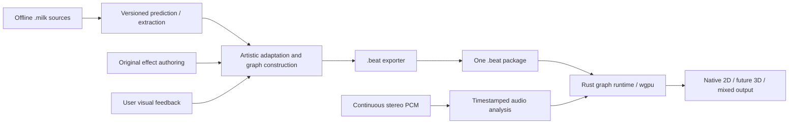

# `.beat` — unified procedural audiovisual effect format

Status: the Rust manifest and structural wgpu graph planner are implemented in
`crates/effect-model/src/beat.rs`. Bounded standalone archive loading/export is implemented. Shader/binding
validation and GPU execution remain in progress. The existing PoC still runs source-derived
equation and warp/composite packages. Current movies retain that producer identity.
The user reviews their visual quality.

## Purpose and decisions

Use one `.beat` format for 2D, 3D and mixed effects. Create high-quality musical
adaptations and original effects, with native 4K detail and bounded rendering
cost. Exact MilkDrop reproduction is not the acceptance target.

Treat `.milk` as an offline import source. Prediction, extraction and adaptation
produce a standalone graph. Shipping playback requires no `.milk` file, MilkDrop
parser, ProjectM engine, predictor installation or legacy fixed-register ABI.
Preserve the original frozen corpus separately for provenance and comparisons.

The latest user decision replaces the earlier `.milk3d` reservation. Dimensionality
belongs to graph operations and capability declarations, not separate extensions.
Do not impose MilkDrop's stage count, shape/wave limits, Q/T registers, authored
canvas dimensions, legacy shader language or unsigned-mono audio interface.

## Package and compatibility

A `.beat` file is a versioned archive with a JSON manifest, portable GPU programs
and declared assets. Keep editable manifests/programs as the authoring form;
export a single installable archive. Select archive compression and cooked-cache
encoding after measured loading/memory probes using maintained libraries.

The manifest declares format/schema versions, effect identity, author/asset
notices, required capabilities, named typed parameters/state, audio bindings,
resources, graph operations and presentation policy. Hash all executable programs
and assets. Source/converter/predictor hashes are provenance metadata, not runtime
dependencies. Original effects can omit import provenance entirely.

Assets can be embedded or explicitly resolved by content hash from an installed
shared catalog. A self-contained export embeds every required asset. A missing
asset or unsupported required capability produces a diagnostic. Optional fallback
graphs must be authored and declared; never silently substitute a generic effect.

WGSL is the initial portable GPU-program representation through wgpu/Naga.
Platform-specific compiled caches are disposable and keyed to program, compiler,
device/backend and format identities. Cache bytes do not replace portable source.
New required operations/representations carry explicit versions and capabilities.
Do not equate extensibility with accepting unknown executable semantics.

## Shared scene and effect graph

### Concrete wgpu target

Optimize the format for wgpu rather than introducing a renderer-neutral engine
abstraction. Owned serializable descriptions map to wgpu texture/buffer formats,
usages, samplers, shader entry points, bind groups, render/compute pipelines,
color/depth attachments and draw/dispatch work. Both dimensions use these same
primitives. Use the project's exact wgpu version when validating capabilities.

Build an execution plan on load: validate WGSL/binding layouts and device features,
order passes, resolve native extents, calculate resource lifetimes/budgets and
allocate pipelines/bind groups/resources. Reuse those objects during playback;
update only audio/control data and encode the prepared work. No JSON parsing,
shader compilation or asset decoding belongs in the per-frame hot path.

Keep texture masters separate from GPU-ready assets. Upload formats, color/alpha
interpretation, per-axis sampler state and mip chains are explicit. Preserve
numeric-map precision and negotiate optional formats/features on device creation.
Mipmap generation is role-aware. Account for mip chains, history copies and shared
asset residency in the memory plan; a4K RGBA8 texture alone occupies64MiB before
mips. PNG decoding and uncompressed byte size do not establish GPU memory cost.

Plan resource usage from actual graph consumers/producers. Apply transient reuse,
draw batching/instancing and compute scheduling only when dependency/lifetime
checks prove they preserve the authored behavior. Cache compilation using declared
wgpu APIs and exact program/layout/backend identities. Measure load latency,
CPU/GPU work, bandwidth, memory and presented-frame deadlines on the target.
Optimization must preserve native primary feedback and final resolution.

Use named typed ports for textures, buffers, scalar/vector parameters and scene
outputs. A frame graph has explicit read/write dependencies and execution order.
Feedback reads an identified previous-frame resource; ordinary same-frame cycles
are rejected. Declare initialization, update, render and reset behavior separately.

Resources declare format, extent, lifetime, initialization and access. Primary
feedback and final output use the native display extent; 4K qualification requires
3840×2160 actual allocations. Smaller blur/simulation resources are explicit
effect intermediates. Any reduced primary-feedback mode is separately identified.

Declare color space/transfer and straight or premultiplied alpha on resources and
blend operations. Use explicit conversions at image-input and display boundaries;
linear scene lighting, HDR storage, exposure/tone mapping and display encoding
must not be inferred from a filename or texture format. HDR nodes require a declared
capability and measured memory/bandwidth budget. A package can choose bounded SDR
resources without changing format or dimensionality.

2D operations include procedural fields, shapes/strokes, wave/spectrum geometry,
instancing, feedback transport, filtering and compositing. They are graph nodes,
not compulsory warp/composite stages. Native stroke widths and antialiasing are
deliberate parameters; adapted output starts with at least three-pixel coverage.

3D capability additions use the same package, audio and resource model: transforms,
cameras, meshes/instances, depth, materials and lighting feed color/depth outputs
into the same compositing/feedback graph. Compute simulation and HDR-capable
resources fit that graph. Initial delivery implements the 2D operations needed by
the adapted corpus; future 3D operations require their own renderer validation.
This is an audiovisual effect runtime, not a general gameplay/physics engine.

Use capability and resource budgets instead of legacy preset limits. Declare
maximum allocation/instance counts and bounded update work. Compile invariant
expressions, specialize programs, batch compatible draws and reuse allocations.
Measure actual native-4K pacing on the selected emulator; source forecasts and
movie encoding rates are not performance evidence.

## Audio, time and control

Consume the shared timestamped high-fidelity audio ABI directly: continuous
signed i16/f32 PCM at its real rate/channels, spectra/envelopes, bass transients,
chroma/tonal change and available stereo information. Each feature retains units,
source sample positions, analysis-window identity and availability/confidence.
Stem separation and reliable instrument isolation are not initial requirements.

Bindings name features and transformations explicitly: gain, clamp, attack/release,
curves and modulation. State/parameters have arbitrary meaningful names. A generic
typed control program may update them; MilkDrop equation parsing and fixed Q/T
transfer conventions stay in the importer. Keep audio analysis independent of
rendering cadence and reset resources/control state on declared generations.

Time policy distinguishes wall time, fixed replay time and simulation steps.
Declare seed/RNG streams and discontinuity/reset behavior. Stateful envelopes and
feedback require timestep-aware authoring; do not hide frame-rate assumptions.

## Prediction-guided adaptation

Inspect the local predictor at
`../Projectm-TV/.worktrees/predictor-visual-loop/tools/milk-analyzer` without changing
its workers, helpers, fixtures or scores. Freeze the inspected commit and relevant
working-file hashes. The tool is being perfected; its historical grades do not
qualify this renderer or this frozen 100-preset corpus.

Use its outputs as a versioned behavior description: scene components, geometry
trajectories, color relationships, temporal events, feedback and audio-control
relationships where supported. Preserve evidence scope and unknowns. Strict
no-display extraction and source-field simulation have different contracts.
Twenty observable claims alone are not an executable effect description; use
equation states, geometry, shader/control structure and assets when needed.

Adapt that description into native graph operations. Eliminate inactive work and
resolve legacy-dependent behavior through explicit adaptation choices. Preserve
recognizable artistic identity while improving coverage, contrast, motion and
musical response according to the user's review. Store those choices as adaptation
provenance. Generate procedural programs, not pre-rendered video playback.

The [Aurora example](https://johnneerdael.github.io/ProjectM-TV/authoring/testing/#aurora-a-preset-designed-to-be-predicted)
demonstrates bounded envelopes, a core/halo/orbit composition, waveform detail and
feedback/glow. These are useful design components for a native `.beat` effect.
Its documented source forecasts and creation checks do not establish this new
effect's quality, correctness or performance.

## Delivery sequence

1. Finish and verify the current paired recordings; preserve the baseline producer.
2. Collect the user's preset-specific visual feedback and retain all 100 outcomes.
3. Implement `.beat` manifest validation, a Rust graph model and package loading;
   exercise mixed graph structure and unsupported-capability diagnostics.
4. Implement native 2D graph execution and an original Aurora-inspired effect
   using generic parameters/audio bindings, with no legacy runtime dependency.
5. Export a source-derived adaptation through predictor-informed build tooling;
   verify standalone playback and native allocations, then measure pacing without
   recording/readback. Expand across the frozen corpus with explicit outcomes.
6. Add actual 3D execution under the same format when that milestone is selected.

Do not rename existing packages to `.beat` and claim this contract is implemented.
Keep original-source translation as an independently selectable diagnostic/reference
route. User visual judgments, input integrity and playback measurements remain
separate evidence.
